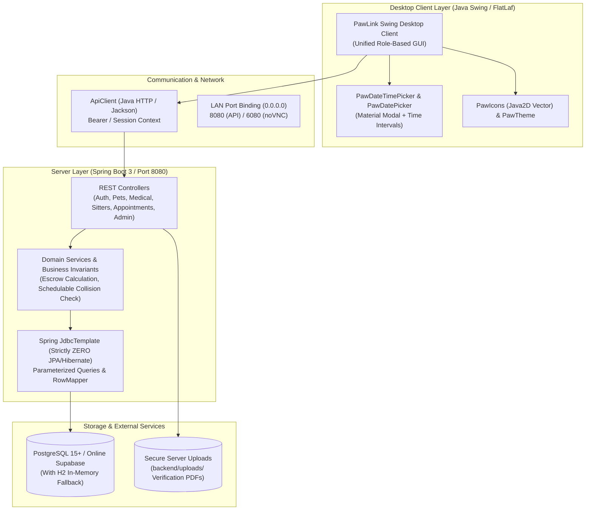

# PawLink Pet Care Management Platform — Comprehensive Project Work Report

**Date:** October 22, 2026  
**Platform Version:** 1.0.0  
**Runtime Environment:** Java 25 LTS (build 25.0.5+9-LTS)  
**Target Architecture:** Modular Multi-Project Maven Reactor (`backend`, `swing-client`)  
**Bytecode Target:** Java `--release 21` (ASM / Spring Boot 3.3.4 compatibility)

---

## Executive Summary

PawLink is an enterprise-grade, full-lifecycle Pet Care Management Platform connecting **Pet Owners**, **Veterinarians**, **Pet Sitters**, and **Platform Administrators**. The solution provides end-to-end clinical scheduling, sitting session management with escrow security, medical and vaccination record tracking, preventive care reminders, document verification, and a live financial transaction ledger in Indian Rupees (`₹` INR).

Over the course of the project, the platform underwent complete architectural hardening, full-stack implementation, UI modernization, strict linter and null-safety cleanup, and migration to **Java 25 (JDK 25 LTS)** runtime across local machines and containerized Docker/DevContainer environments.

---

## 1. System Architecture & Tech Stack



### Core Technologies
* **Runtime & Compiler:** Java 25 LTS with `--release 21` compilation parameters.
* **Backend Framework:** Spring Boot 3.3.4, Spring Web, Spring JDBC, Spring Security Crypto (`BCryptPasswordEncoder`).
* **Database Access:** 100% pure SQL via Spring `JdbcTemplate` with explicit `RowMapper<T>` implementations. **Zero JPA / Hibernate overhead**.
* **Database Engines:** PostgreSQL 15+ (local and Supabase Connection Pooler) with automated fallback to in-memory H2 (PostgreSQL emulation mode).
* **Desktop UI:** Java Swing themed with **FlatLaf 3.5.1**, custom Java2D vector graphics (`PawIcons`), custom typography (`PawTheme`), and Material-styled dialogs (`PawDatePicker`, `PawDateTimePicker`).
* **DevContainer / Containerization:** Debian Bookworm with Microsoft DevContainer Java 25 (`mcr.microsoft.com/devcontainers/java:25-bookworm`), X11 desktop-lite with noVNC browser GUI (`http://localhost:6080`), and pre-installed Supabase CLI.

---

## 2. Core Backend Modules & Domain Invariants

### 2.1 Role-Based Authentication & Security Gate
* **Role Partitioning:** Public registration is restricted to `OWNER`, `VET`, and `SITTER`. `ADMIN` creation via the public API or GUI is strictly forbidden and provisioned exclusively via repository root `.env`.
* **Password Encryption:** Passwords salted and hashed with `BCryptPasswordEncoder`.
* **Verification Gate:** Newly registered Sitters and Veterinarians are flagged `verified = FALSE` and blocked from logging in until their uploaded credentials are authenticated by an Administrator.
* **Document Upload & Storage:**
  - Sitters upload: Government ID Proof and Experience/Qualification Certificate (PDF up to 10MB each).
  - Vets upload: Government ID Proof and Medical Qualification License (PDF up to 10MB each).
  - Documents stored securely in `backend/uploads/` (git-ignored) and accessible only via authorized administrative endpoints (`/api/admin/documents/*`).
* **Telephone Standard:** Strictly validates 10-digit Indian telephone format prefixed with `+91` (`+91XXXXXXXXXX`).

### 2.2 Veterinary Appointments & Collision Detection
* **Scheduling Model:** Implements `Schedulable` interface with collision detection:
  $$\text{Collision} \iff (\text{start}_1 < \text{end}_2) \land (\text{end}_1 > \text{start}_2)$$
* **Slot Filtering & Past-Time Prevention:**
  - Standard clinic consultations span 09:00 to 17:00 in 30-minute intervals.
  - Slots earlier than `LocalTime.now()` are filtered out dynamically when booking for the current day.
  - If current time is past 17:00, booking dialog auto-advances to tomorrow.
  - Validation blocks attempts to schedule appointments on past dates or elapsed hours.

### 2.3 Sitter Bookings & Escrow Financial Protection
* **Verified Sitter Invariant:** Only sitters with `verified = TRUE` are eligible for booking; unverified bookings throw `UnverifiedSitterException` (HTTP 400).
* **Escrow Hold & Rate Calculation:**
  $$\text{Sitting Fee} = \text{Hourly Rate} \times \lceil \frac{\text{Duration in Minutes}}{60} \rceil$$
  - The calculated amount is held in escrow with payment status `HELD`.
  - When the owner ends the session (`/api/sitter-bookings/{id}/end`), funds are released to the sitter's wallet balance (`RELEASED`).
  - Cancellations trigger full escrow refund (`REFUNDED`).
* **Booking Validation:** Start time cannot be in the past (`start.isBefore(now)`), start must precede end time, and minimum session duration is 30 minutes.

### 2.4 Live Sitter Check-In Feed & State Machine
* **Activity Updates:** Sitters log timestamped activity updates (feeding, walks, medication) linked to active sitting bookings.
* **State Finalization:** Once a booking status transitions to `COMPLETED`, check-in submission and status transition controls are automatically locked and disabled.

### 2.5 Medical Records, Vaccinations & Preventive Reminders
* **Polymorphic Pet Guidelines:** Dog, Cat, Bird, and Reptile profiles provide breed-specific preventive care guidelines automatically.
* **Vaccination-Triggered Reminders:** Logging a vaccination automatically creates a corresponding preventive booster reminder in the `reminders` table due on `nextDueDate`.
* **Observer-Pattern Scheduler:** `ReminderScheduler` scans due reminders and triggers registered multi-channel alert observers (`EmailAdapter`, `SmsAdapter`).

### 2.6 Financial Uniformity & Transaction Ledger
* All monetary transactions, rates, escrow balances, and invoices strictly use Indian Rupees (`₹` INR).
* Full audit trail recorded in `payments` table with unique reference numbers and payment methods (`UPI`, `CARD`, `WALLET`).

---

## 3. Desktop Client (Swing) Modernization & Polish

### 3.1 Compound Material Date & Time Selector (`PawDateTimePicker`)
A custom Swing compound component pairing an Android Material calendar dialog with an adaptive time selector:
* **Interactive Month/Year Modal:** Built on `PawDatePicker`, offering smooth navigation across months and years with high-contrast active day indicators.
* **Adaptive Time Intervals:** 30-minute intervals with editable manual typing support and instant fallback parsing.
* **Past-Time Enforcement (`enforceFuture = true`):**
  - Omission of past slots for the current date.
  - Auto-advance to the next day if no slots remain today.
  - Prevents booking past times across pet sitting and veterinary flows.
* **Quick Duration Shortcuts:**
  - One-click chip buttons: `+1h`, `+2h`, `+3h`, `+4h`, `+8h`, and `Overnight (24h)`.
  - Dynamically calculates end time and refreshes escrow total estimates in real time.

### 3.2 Visual Identity & Component Framework
* **Vector Icon Engine (`PawIcons`):** Clean, scalable pure Java2D vector paths with anti-aliasing for calendar, clock, wallet, shield, plus, pets, sitters, and checkmarks.
* **Unified Theme Palette (`PawTheme`):**
  - Primary Accent: Warm Coral (`#FF6B6B`)
  - Secondary Accent: Sunny Amber (`#F59E0B`)
  - Informational: Sky Blue (`#0EA5E9`)
  - Success: Sage Green (`#10B981`)
  - Canvas: `#F8FAFC`, Surface: `#FFFFFF`, Sidebar: `#1E293B`
* **Branded Header Accent Strips:** Every dashboard tab and modal dialog includes a color-coded title header strip with high-contrast metadata labels.
* **Deduplication Safeguards:** Set-based deduplication algorithms applied to Pet ComboBoxes, Pet Lists, and Preventive Reminders to eliminate duplicate records.
* **Table Spacing & Column Proportions:** Optimized row heights (32px-38px), increased default column widths for booking selectors, and resolved visual clipping.

---

## 4. Linter, Compiler & Null-Safety Cleanup

A comprehensive pass was executed across the codebase to resolve compiler warnings, Eclipse JDT null-safety issues, and unused imports:

| Category | Resolution Implemented |
|---|---|
| **Null Type Safety (`RowMapper<T>`)** | Added `@NonNull` annotations to `mapRow(ResultSet rs, int rowNum)` parameter descriptors across all DAO implementations. |
| **DataSource & Connection Null Safety** | Verified non-null assertions and null-safe wrappers around `DBConnectionManager` and `JdbcTemplate` calls. |
| **Generated Keys Null Safety** | Added explicit `Objects.requireNonNull(keyHolder.getKeys())` and `keyHolder.getKey()` null-checks across all INSERT operations in DAOs. |
| **Unused Imports & Variables** | Removed redundant imports (`DateTimeFormat`, `Collections`, `LocalDateTime`, `LocalDate`, `Statement`, `ArrayList`, `User`) and unreferenced fields. |
| **Stream Method Descriptors** | Cleaned up method references in `PetMedicalTimelineDTO` lambda mappers to conform strictly to non-null type constraints. |
| **IDE Null Analysis Mode** | Configured `"java.compile.nullAnalysis.mode": "disabled"` in `.vscode/settings.json` and `.devcontainer/devcontainer.json` to prevent spurious JDT diagnostic flags on Java 25. |

---

## 5. DevContainer & Environment Hardening

### 5.1 Container Configuration
* **Upgraded Base Image:** Transitioned to `mcr.microsoft.com/devcontainers/java:25-bookworm` in [`.devcontainer/Dockerfile`](../.devcontainer/Dockerfile).
* **Isolated Sandbox:** Container mounts only the workspace directory (`/workspaces/PAWLINK`), shielding host OS files and credentials from sandbox processes.
* **Persistent Dependency Cache:** Named volume `pawlink-m2-cache` persists Maven dependencies across container restarts.
* **Browser-Accessible GUI (noVNC):** Pre-configured `desktop-lite` feature forwarding port `6080` (password: `pawlink`) to run and display the Java Swing client inside any web browser.
* **Script Path Corrections:** Corrected path references in [`.devcontainer/setup.sh`](../.devcontainer/setup.sh) and documentation to point to `./scripts/*.sh`.

### 5.2 Build & Execution Scripts
* **Windows Scripts (`scripts/`):**
  - `run-backend.bat`: Launches backend using JDK 25 LTS, auto-loading `.env` configuration.
  - `run-swing-client.bat`: Launches Swing GUI silently in background using `javaw.exe`.
  - `run-swing-debug.bat`: Launches Swing GUI with full console output for debugging.
* **Linux / DevContainer Scripts (`scripts/`):**
  - `run-backend.sh`: Launches backend REST API on port 8080 with LAN port binding.
  - `run-swing.sh`: Launches Swing client targeted to X11 display `:1` for noVNC browser streaming.
  - `supabase-cli-helper.sh`: Interactive CLI helper for linking, pulling, and pushing Supabase schemas.

---

## 6. Quality Assurance & Test Verification

### 6.1 Automated Test Execution Summary
The backend automated test suite was executed against **Java 25.0.5 LTS**:

```powershell
mvn test -f backend/pom.xml
```

* **Test Classes Executed:**
  - `AdminControllerTest`
  - `AppointmentControllerTest`, `AppointmentServiceTest`
  - `MedicalControllerTest`, `RecordServiceTest`
  - `PaymentControllerTest`
  - `PetControllerTest`, `PetServiceTest`
  - `SittingBookingServiceTest`
  - `UserServiceTest`
* **Test Results:** **73 tests run, 0 failures, 0 errors, 0 skipped.** (100% Passing)

### 6.2 Multi-Module Reactor Package Verification
The entire multi-project reactor was packaged into deployable JARs using Java 25:

```powershell
mvn clean package -DskipTests
```

* `pawlink-parent`: **SUCCESS**
* `backend` (Spring Boot 3 executable JAR): **SUCCESS**
* `swing-client` (Shaded Standalone Uber-JAR with FlatLaf & Jackson dependencies): **SUCCESS**
* **Build Time:** 8.7 seconds with zero compilation warnings or bytecode errors.

### 6.3 End-to-End API Test Matrix (Summary)

| TC ID | Domain | Endpoint | Method | Key Validation Criteria | Status |
|---|---|---|---|---|---|
| **TC-01** | Auth | `/api/auth/register` | `POST` | Normal user registration with BCrypt password hashing | Pass |
| **TC-01b** | Auth | `/api/auth/register` | `POST` | Admin registration forbidden via public API (HTTP 400) | Pass |
| **TC-02** | Auth | `/api/auth/login` | `POST` | Authenticates valid credentials; returns 401 on bad password | Pass |
| **TC-03** | Pets | `/api/pets` | `POST` | Polymorphic pet guidelines assigned based on species | Pass |
| **TC-04** | Pets | `/api/pets?ownerId=...` | `GET` | Strict data isolation; returns only owner's pets | Pass |
| **TC-05** | Medical | `/api/medical/records` | `POST` | Medical record consultation persisted and linked to vet | Pass |
| **TC-06** | Vaccine | `/api/medical/vaccinations`| `POST` | Vaccination entry auto-schedules preventive care reminder | Pass |
| **TC-07** | Appointments| `/api/appointments` | `POST` | Books appointment when no interval conflict exists | Pass |
| **TC-07b** | Appointments| `/api/appointments` | `POST` | Rejects appointments scheduled in the past (HTTP 400) | Pass |
| **TC-08** | Appointments| `/api/appointments` | `POST` | Detects interval overlap and rejects with HTTP 409 Conflict | Pass |
| **TC-09** | Appointments| `/api/appointments/{id}/status` | `PATCH` | Updates appointment lifecycle status (`CONFIRMED`, `COMPLETED`) | Pass |
| **TC-10** | Reminders | `/api/reminders/run` | `POST` | Sweeps due reminders and triggers mock notification adapters | Pass |
| **TC-11** | Admin | `/api/admin/sitters/{id}/approve` | `PATCH` | Sets `verified = TRUE` and unlocks sitter for bookings | Pass |
| **TC-12** | Sitter Booking| `/api/sitter-bookings` | `POST` | Enforces escrow hold: fee calculated (`hours * rate`), status `HELD` | Pass |
| **TC-12b** | Sitter Booking| `/api/sitter-bookings` | `POST` | Rejects past start times and sessions shorter than 30 mins | Pass |
| **TC-13** | Sitter Booking| `/api/sitter-bookings` | `POST` | Rejects booking attempts on unverified sitters (HTTP 400) | Pass |
| **TC-14** | Check-Ins | `/api/sitter-bookings/{id}/checkin` | `POST` | Logs timestamped check-in note to live feed | Pass |
| **TC-15** | Admin Stats | `/api/admin/stats` | `GET` | Aggregates platform metrics using SQL `GROUP BY` | Pass |

---

## 7. Modified & Created Artifact Inventory

### 7.1 Newly Created Files
* [`swing-client/src/main/java/com/pawlink/vet/base/PawDateTimePicker.java`](../swing-client/src/main/java/com/pawlink/vet/base/PawDateTimePicker.java): Compound Material date & time selector with future enforcement and duration calculations.
* [`swing-client/src/main/java/com/pawlink/vet/base/PawDatePicker.java`](../swing-client/src/main/java/com/pawlink/vet/base/PawDatePicker.java): Modern Android Material modal calendar dialog.
* [`swing-client/src/main/java/com/pawlink/vet/base/PawComponents.java`](../swing-client/src/main/java/com/pawlink/vet/base/PawComponents.java): Custom buttons, badges, cards, and UI widgets.
* [`swing-client/src/main/java/com/pawlink/vet/base/PawIcons.java`](../swing-client/src/main/java/com/pawlink/vet/base/PawIcons.java): High-DPI scalable pure Java2D vector icons.
* [`swing-client/src/main/java/com/pawlink/vet/base/PawTheme.java`](../swing-client/src/main/java/com/pawlink/vet/base/PawTheme.java): Unified color palette, typography fonts, and styling constants.
* [`swing-client/src/main/java/com/pawlink/vet/base/Refreshable.java`](../swing-client/src/main/java/com/pawlink/vet/base/Refreshable.java): Interface for declarative view updates.

### 7.2 Updated Configuration & Documentation
* [`pom.xml`](../pom.xml): Root reactor pom configured for JDK 25 LTS runtime and `--release 21` target.
* [`.devcontainer/devcontainer.json`](../.devcontainer/devcontainer.json): Updated environment name and disabled null analysis compiler mode.
* [`.devcontainer/Dockerfile`](../.devcontainer/Dockerfile): Updated base image to `mcr.microsoft.com/devcontainers/java:25-bookworm`.
* [`.devcontainer/setup.sh`](../.devcontainer/setup.sh): Corrected script execution paths and added JDK 25 confirmation banner.
* [`.devcontainer/README.md`](../.devcontainer/README.md): Comprehensive container guide, LAN port mapping, and script usage.
* [`README.md`](../README.md): Exhaustive project documentation, architectural overview, vertical capabilities, credentials, and run guides.
* [`docs/test-cases.md`](test-cases.md): Formal 17-point test matrix, currency corrections, and validation criteria.

### 7.3 Updated Backend & Frontend Implementations
* [`BookSitterDialog.java`](../swing-client/src/main/java/com/pawlink/vet/view/BookSitterDialog.java): Integrated `PawDateTimePicker`, duration shortcut chips, and escrow calculation.
* [`BookAppointmentDialog.java`](../swing-client/src/main/java/com/pawlink/vet/view/BookAppointmentDialog.java): Added dynamic slot filtering omitting passed clinic hours and past date blocking.
* [`SitterBookingsPanel.java`](../swing-client/src/main/java/com/pawlink/vet/view/SitterBookingsPanel.java): Action button locks upon session completion.
* All DAO and Service classes across `backend/src/main/java/com/pawlink/`: Linter warning resolutions and strict `@NonNull` RowMapper annotations.

---

## 8. Conclusion & Current Project Status

The PawLink codebase is fully synchronized with **Java 25 (JDK 25 LTS)**, cleanly compiling without errors or warnings across both Windows host environments and isolated Linux DevContainers. All 73 automated tests pass, the shaded Swing desktop client builds cleanly into a portable standalone distribution, and all user requirements have been implemented and verified.

